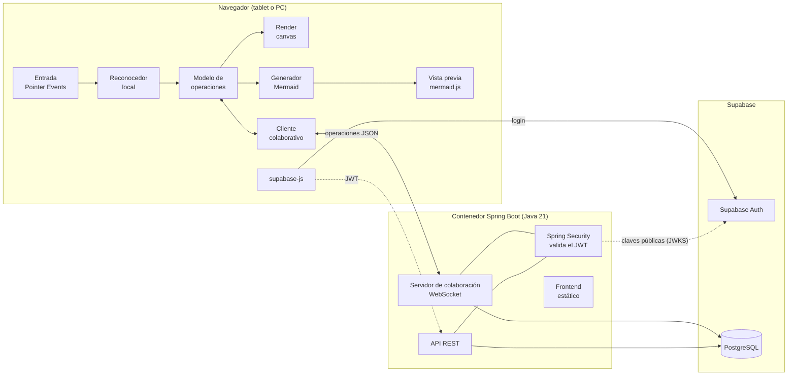
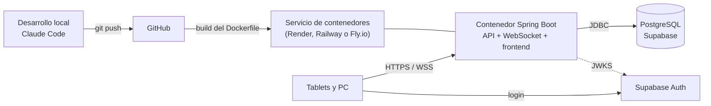
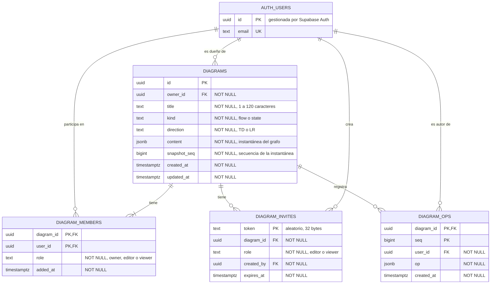

## Índice

0. [Ficha del proyecto](#0-ficha-del-proyecto)
1. [Descripción general del producto](#1-descripción-general-del-producto)
2. [Arquitectura del sistema](#2-arquitectura-del-sistema)
3. [Modelo de datos](#3-modelo-de-datos)
4. [Especificación de la API](#4-especificación-de-la-api)
5. [Historias de usuario](#5-historias-de-usuario)
6. [Tickets de trabajo](#6-tickets-de-trabajo)
7. [Pull requests](#7-pull-requests)

**Estado del proyecto (1 oct 2026):** existe un prototipo funcional que solo usa el navegador
(commit `5ea5e8a`). El MVP descrito en este documento está diseñado y planificado en
[docs/PRD-MVP.md](docs/PRD-MVP.md), pero todavía no está implementado. Las secciones marcadas como
*pendiente* se completarán durante el desarrollo.

---

## 0. Ficha del proyecto

### **0.1. Tu nombre completo:**

Alvaro Bernal Sancho

### **0.2. Nombre del proyecto:**

**pen2mermaid**: dibuja a mano, colabora y obtén Mermaid.

El proyecto empezó como "Trazo a Mermaid". El nombre nuevo describe lo que hace la app ("de lápiz a
Mermaid") y deja claro que produce código Mermaid sin presentarse como un producto oficial de Mermaid ni
de Mermaid Chart.

### **0.3. Descripción breve del proyecto:**

Pizarra colaborativa para dibujar diagramas con lápiz en una tablet que los convierte en tiempo real
en código [Mermaid](https://mermaid.js.org/). Cada trazo se reconoce en el propio dispositivo como una
forma del tipo de diagrama elegido (flujo o estados UML) o como un conector entre formas. Varios
usuarios pueden dibujar a la vez en el mismo diagrama y todos ven el mismo resultado y el mismo código.

### **0.4. URL del proyecto:**

> Puede ser pública o privada, en cuyo caso deberás compartir los accesos de manera segura. Puedes enviarlos a [alvaro@lidr.co](mailto:alvaro@lidr.co) usando algún servicio como [onetimesecret](https://onetimesecret.com/).

*Pendiente:* se publicará en la sesión 8 del plan (despliegue en un servicio de contenedores).

### 0.5. URL o archivo comprimido del repositorio

> Puedes tenerlo alojado en público o en privado, en cuyo caso deberás compartir los accesos de manera segura. Puedes enviarlos a [alvaro@lidr.co](mailto:alvaro@lidr.co) usando algún servicio como [onetimesecret](https://onetimesecret.com/). También puedes compartir por correo un archivo zip con el contenido

https://github.com/sanchico/AI4Devs-finalproject-abs

---

## 1. Descripción general del producto

> Describe en detalle los siguientes aspectos del producto:

### **1.1. Objetivo:**

> Propósito del producto. Qué valor aporta, qué soluciona, y para quién.

**Problema.** Dibujar diagramas con lápiz es la forma más rápida de pensar un sistema o un proceso, pero
las herramientas actuales obligan a elegir:

- Las apps de notas que convierten formas, como Samsung Notes, no dejan elegir qué formas reconocen ni
  entienden las reglas de un diagrama: una flecha no queda realmente unida a las cajas que conecta.
- Los editores de diagramas, como draw.io, sí conocen la notación, pero están pensados para arrastrar
  formas con el ratón, no para dibujar.
- Las herramientas que convierten fotos de bocetos a Mermaid (SketchFlow, ImageToEditable, Image to
  Mermaid) trabajan sobre un dibujo terminado y con IA: el resultado llega después, puede interpretar
  mal el boceto y no se corrige mientras se dibuja.

**Solución.** pen2mermaid reconoce cada trazo en el momento en que se levanta el lápiz y lo
incorpora a un grafo de nodos y conexiones. El tipo de diagrama elegido limita las formas posibles, de
modo que el reconocimiento es predecible. El código Mermaid se genera recorriendo el grafo, sin IA, y se
actualiza con cada trazo.

**Valor:**
- Un diagrama dibujado a mano queda convertido en texto versionable, que se puede pegar en GitHub,
  GitLab, Notion, Obsidian o en la documentación de un proyecto.
- El reconocimiento es local: instantáneo, gratuito y funciona sin conexión.
- Varias personas pueden construir el diagrama juntas, cada una desde su tablet, en una reunión, una
  clase o una sesión de diseño.

**Para quién:** desarrolladores y arquitectos que diseñan en equipo, docentes que explican con diagramas,
y analistas o product managers que capturan procesos en talleres.

### **1.2. Características y funcionalidades principales:**

> Enumera y describe las características y funcionalidades específicas que tiene el producto para satisfacer las necesidades identificadas.

| Funcionalidad | Descripción | Estado |
|---|---|---|
| Dibujo con lápiz | El lápiz dibuja y el dedo mueve nodos; con ratón, un botón elige si dibuja o mueve | Prototipo |
| Tipo de diagrama | Flujo (proceso, decisión, inicio/fin) o estados UML (estado, elección, inicio/fin `[*]`). El tipo limita las formas que se reconocen | Prototipo |
| Reconocimiento de formas | Un trazo cerrado se clasifica como rectángulo, rombo o elipse con dos métricas geométricas, en el dispositivo | Prototipo |
| Conectores | Un trazo abierto que empieza en una forma y acaba en otra crea una arista dirigida | Prototipo |
| Etiquetas | Un toque sobre un nodo o un conector permite editar su texto o borrarlo | Prototipo |
| Código Mermaid en vivo | Panel con la vista previa renderizada, el código y un botón para copiarlo | Prototipo |
| Cuentas de usuario | Registro e inicio de sesión con email y contraseña (Supabase Auth). Se puede dibujar sin cuenta; para guardar hace falta | MVP |
| Mis diagramas | Lista de diagramas propios y compartidos, con su rol; crear, abrir y borrar | MVP |
| Colaboración en tiempo real | Varios usuarios dibujan a la vez en el mismo diagrama y ven los cambios de los demás en menos de un segundo | MVP |
| Invitaciones | El dueño comparte un enlace que añade a otro usuario como editor o como lector | MVP |
| Presencia | Se ve quién está conectado al diagrama | MVP |
| Deshacer por usuario | Cada persona deshace solo sus propios cambios | MVP |
| Recuperación tras cortes | Al volver la conexión, el cliente recibe los cambios que se ha perdido | MVP |

Queda para después del MVP (ver [docs/PRD-MVP.md](docs/PRD-MVP.md)): nuevos tipos de diagrama (clases
UML, entidad-relación, secuencia y el resto de tipos de Mermaid), pan y zoom, escritura a mano para las
etiquetas e importación de código Mermaid.

### **1.3. Diseño y experiencia de usuario:**

> Proporciona imágenes y/o videotutorial mostrando la experiencia del usuario desde que aterriza en la aplicación, pasando por todas las funcionalidades principales.

*Pendiente:* las capturas se generarán al final del desarrollo (sesión 12) con la skill
`run-trazo-mermaid`. Recorrido previsto:

1. Pantalla inicial con un diagrama de ejemplo: lienzo a la izquierda y vista previa y código Mermaid
   a la derecha.
2. Dibujar un rectángulo, un rombo y una elipse, y ver cómo se convierten en nodos.
3. Conectar dos formas con un trazo y editar la etiqueta de un nodo y de un conector.
4. Iniciar sesión y abrir "Mis diagramas".
5. Invitar a otro usuario y ver a los dos dibujando en el mismo diagrama desde dos dispositivos.
6. Copiar el código Mermaid generado.

### **1.4. Instrucciones de instalación:**
> Documenta de manera precisa las instrucciones para instalar y poner en marcha el proyecto en local (librerías, backend, frontend, servidor, base de datos, migraciones y semillas de datos, etc.)

**Prototipo actual (solo frontend).** No tiene dependencias ni build: basta con servir la carpeta.

```bash
python -m http.server 8000
```

Abrir `http://localhost:8000`. Para probar en la tablet, abrir `http://<ip-del-pc>:8000` desde la misma
red.

**MVP (previsto).** *Pendiente de confirmar al implementarlo.* Requisitos: Java 21, Maven 3.9,
Docker y una cuenta de Supabase.

1. Crear un proyecto en Supabase y copiar su URL, su clave pública y la cadena de conexión de la base
   de datos.
2. Copiar `backend/.env.example` a `backend/.env` y rellenar esas variables.
3. Arrancar PostgreSQL en local: `docker compose up -d`.
4. Arrancar el backend: `mvn -f backend spring-boot:run`. Flyway aplica las migraciones al arrancar.
5. Abrir `http://localhost:8080`: el backend sirve también el frontend.
6. Ejecutar los tests: `node --test` (frontend) y `mvn -f backend verify` (backend, necesita Docker
   para Testcontainers).

---

## 2. Arquitectura del Sistema

### **2.1. Diagrama de arquitectura:**
> Usa el formato que consideres más adecuado para representar los componentes principales de la aplicación y las tecnologías utilizadas. Explica si sigue algún patrón predefinido, justifica por qué se ha elegido esta arquitectura, y destaca los beneficios principales que aportan al proyecto y justifican su uso, así como sacrificios o déficits que implica.

Arquitectura prevista para el MVP:



**Patrón:** cliente con lógica de dominio local y **servidor autoritativo** de colaboración, dentro de
un monolito modular en Spring Boot.

- El **cliente** hace todo lo que tiene que ser instantáneo: capturar el trazo, reconocerlo, convertirlo
  en una operación sobre el grafo, aplicarla y generar el Mermaid.
- El **servidor** es la autoridad sobre el estado compartido. Para cada diagrama abierto mantiene una
  sala en memoria; valida cada operación (formato, permisos, que los elementos existan), le asigna un
  número de secuencia, la guarda y la reenvía al resto de clientes.
- Si dos usuarios cambian el mismo campo a la vez, prevalece el último en el orden del servidor
  (*last-writer-wins*). Los cambios sobre elementos distintos no entran en conflicto.
- **Supabase** aporta la autenticación y la base de datos gestionadas.

**Por qué esta arquitectura:**
- **Reconocimiento local, sin IA por trazo.** Un modelo de lenguaje por trazo sería lento (segundos por
  llamada), caro e inestable, porque podría reinterpretar el diagrama entero cada vez. Un reconocedor
  geométrico acotado por el tipo de diagrama responde en milisegundos y siempre igual.
- **Modelo de grafo, no de dibujo.** Los conectores son aristas entre nodos. Por eso el Mermaid se genera
  recorriendo el grafo, y por eso colaborar consiste en compartir operaciones pequeñas y sin ambigüedad
  ("añadir nodo", "cambiar etiqueta"), no trazos ni imágenes.
- **Servidor autoritativo con *last-writer-wins* por campo** en lugar de CRDT o transformación
  operacional. El modelo es un grafo con campos discretos, no un texto largo que editar a la vez, así
  que basta con ordenar las operaciones.
- **Supabase Auth** resuelve el registro, las sesiones y las contraseñas; el backend solo valida el token.

**Beneficios:** respuesta inmediata al dibujar; funciona sin conexión para dibujar; mensajes de red de
pocos bytes; una sola implementación de las reglas de permisos, en el servidor; una única URL para la
app, la API y el WebSocket.

**Sacrificios y déficits:**
- La lógica de aplicar operaciones existe dos veces, en JavaScript y en Java, y ambas deben dar el mismo
  resultado. Se mitiga con casos de prueba compartidos que ejecutan los dos lados.
- Las salas viven en memoria de una sola instancia: no escala horizontalmente sin añadir un broker.
- Si dos personas editan la misma etiqueta a la vez, una de las dos ediciones se pierde.
- Dependencia de un proveedor externo (Supabase) para la autenticación y la base de datos.
- Dos lenguajes en el proyecto (JavaScript y Java).

### **2.2. Descripción de componentes principales:**

> Describe los componentes más importantes, incluyendo la tecnología utilizada

| Componente | Tecnología | Responsabilidad |
|---|---|---|
| Entrada | Pointer Events | Distingue lápiz, dedo y ratón. El lápiz dibuja, el dedo mueve y un toque edita |
| Reconocedor | JavaScript, geometría | Clasifica un trazo cerrado entre las formas del tipo activo (área relativa a su caja y distancia media a las esquinas) y detecta conectores entre formas |
| Modelo de operaciones | JavaScript | Único punto de cambio del grafo (`apply(op)`); identificadores UUID; deshacer por usuario con operaciones inversas |
| Generador Mermaid | JavaScript | Recorre el grafo y emite el código según el tipo (`flowchart`, `stateDiagram-v2`) |
| Render y vista previa | Canvas 2D, mermaid.js 10.9.1 | Dibuja el grafo limpio y renderiza el código con `securityLevel: 'strict'` |
| Cliente colaborativo | WebSocket del navegador | Envía operaciones, aplica las remotas, reconcilia las propias pendientes y reconecta |
| Autenticación en el cliente | supabase-js | Registro, inicio de sesión y renovación del token |
| Servidor de colaboración | Spring WebSocket | Salas por diagrama, cola de operaciones por sala, validación, persistencia, reenvío y presencia |
| API REST | Spring Web, Bean Validation, springdoc-openapi | Diagramas, miembros e invitaciones; documentación OpenAPI |
| Seguridad | Spring Security (resource server OAuth2) | Valida el JWT de Supabase en la API y en el WebSocket |
| Persistencia | Spring Data JPA, Flyway, PostgreSQL | Tablas, migraciones, registro de operaciones e instantáneas |

### **2.3. Descripción de alto nivel del proyecto y estructura de ficheros**

> Representa la estructura del proyecto y explica brevemente el propósito de las carpetas principales, así como si obedece a algún patrón o arquitectura específica.

**Estructura actual (prototipo):**

```
trazo-mermaid/
├── index.html        Página única
├── app.js            Toda la lógica: tipos, reconocedor, modelo, render, entrada y generación
├── styles.css        Estilos con tema claro y oscuro
├── CLAUDE.md         Contexto del proyecto para Claude Code
├── prompts.md        Prompts principales (entrega del curso)
├── readme.md         Este documento
└── docs/             PRD, bitácora y conversación de origen
```

**Estructura prevista para el MVP** (el repositorio se publicará en GitHub como `AI4Devs-finalproject-abs`):

```
AI4Devs-finalproject-abs/
├── frontend/                 HTML y JS en módulos ES, sin build
│   ├── index.html
│   ├── styles.css
│   └── js/
│       ├── geometry.js       Utilidades geométricas
│       ├── recognizer.js     Reconocimiento de trazos
│       ├── model.js          Grafo y apply(op)
│       ├── ops.js            Tipos de operación e inversas
│       ├── kinds/            Un módulo por tipo de diagrama (formas y generación)
│       ├── render.js         Canvas y vista previa
│       ├── input.js          Pointer Events
│       ├── collab.js         Cliente WebSocket
│       ├── api.js            Cliente REST y supabase-js
│       └── main.js           Arranque
├── backend/                  Proyecto Maven, Spring Boot
│   └── src/main/java/…
│       ├── collab/           Salas, protocolo y aplicación de operaciones
│       ├── diagrams/         API REST, entidades y repositorios
│       ├── invites/          Invitaciones y miembros
│       └── security/         Configuración de Spring Security y JWT
├── shared/fixtures/          Casos de prueba de operaciones que ejecutan los tests de JS y de Java
├── tests/                    Tests del frontend (node --test) y trazos grabados
├── docs/                     PRD, bitácora y conversación de origen
├── Dockerfile
└── docker-compose.yml        PostgreSQL local
```

El backend se organiza **por funcionalidad** (colaboración, diagramas, invitaciones, seguridad) en lugar
de por capas técnicas, que es la forma habitual de un monolito modular. El frontend se mantiene sin
build ni dependencias, uno de los principios del proyecto, para poder abrirlo y probarlo en cualquier
navegador.

### **2.4. Infraestructura y despliegue**

> Detalla la infraestructura del proyecto, incluyendo un diagrama en el formato que creas conveniente, y explica el proceso de despliegue que se sigue

Infraestructura prevista:



**Proceso de despliegue previsto:**
1. Cada bloque de trabajo se desarrolla en una rama y entra en `main` por pull request, con los tests en
   verde.
2. Un `Dockerfile` multi-etapa compila el backend con Maven, incluye el frontend como recursos estáticos
   y genera una imagen con el JAR.
3. El servicio de contenedores construye y despliega la imagen al actualizarse `main`.
4. Las variables de entorno (conexión a la base de datos, URL del proyecto de Supabase) se configuran en
   el servicio; nunca se guardan en el repositorio.
5. Flyway aplica las migraciones pendientes al arrancar.

*Pendiente:* elegir el servicio de contenedores en la sesión 8, según sus planes gratuitos y su soporte
de WebSocket.

### **2.5. Seguridad**

> Enumera y describe las prácticas de seguridad principales que se han implementado en el proyecto, añadiendo ejemplos si procede

Prácticas previstas (*pendiente de implementar*):

- **Autenticación con JWT:** el backend valida la firma del token de Supabase con sus claves públicas
  (JWKS), además del emisor y la audiencia `authenticated`. Se valida tanto en la API como en el
  WebSocket.
- **Token en el primer mensaje del WebSocket, no en la URL:** el navegador no permite cabeceras en
  WebSocket, y las URL acaban registradas en los logs.
- **Renovación y caducidad:** el cliente renueva el token antes de que caduque; el servidor cierra la
  conexión si caduca sin renovarse.
- **Permisos por operación:** el servidor comprueba el rol (dueño, editor o lector) en cada operación
  recibida, no solo al conectar. Un lector recibe un error si intenta modificar.
- **No revelar la existencia de recursos ajenos:** un diagrama del que no se es miembro responde 404, no
  403.
- **Seguridad de fila (RLS) en Supabase:** Supabase publica automáticamente las tablas del esquema
  `public` en su propia API REST. Se activa RLS sin políticas en todas las tablas para cerrar esa vía; el
  backend se conecta con un rol de servidor.
- **Prevención de XSS:** la vista previa de Mermaid usa `securityLevel: 'strict'`. Con diagramas
  compartidos, una etiqueta como `` se ejecutaría en el navegador de todos
  los miembros; con `strict` se muestra como texto.
- **Validación de entrada:** esquema de cada operación, etiquetas de 200 caracteres como máximo y 500 nodos
  por diagrama.
- **Invitaciones:** tokens aleatorios de 32 bytes con caducidad de 7 días.
- **Secretos:** solo en variables de entorno; `.env` excluido del repositorio.

### **2.6. Tests**

> Describe brevemente algunos de los tests realizados

Tests previstos (*pendiente de implementar*):

- **Reconocedor:** trazos reales grabados con el S Pen (fixtures JSON, al menos 10 por forma). El test
  mide la precisión por forma, con un mínimo del 90 %. Runner nativo de Node (`node --test`), sin
  dependencias.
- **Generación de Mermaid:** para un grafo de ejemplo de cada tipo, el código generado coincide con el
  esperado.
- **Operaciones compartidas:** secuencias de operaciones con su grafo resultante, en
  `shared/fixtures/ops`, ejecutadas tanto por los tests de JavaScript como por los de Java.
- **API:** tests con MockMvc y tokens simulados: sin token (401), usuario sin acceso (404), lector que
  intenta editar.
- **Base de datos:** migraciones y repositorios contra un PostgreSQL real con Testcontainers.
- **Convergencia:** varios clientes WebSocket envían operaciones concurrentes sobre los mismos elementos;
  al terminar, todos tienen el mismo estado que el servidor.

---

## 3. Modelo de Datos

### **3.1. Diagrama del modelo de datos:**

> Recomendamos usar mermaid para el modelo de datos, y utilizar todos los parámetros que permite la sintaxis para dar el máximo detalle, por ejemplo las claves primarias y foráneas.



### **3.2. Descripción de entidades principales:**

> Recuerda incluir el máximo detalle de cada entidad, como el nombre y tipo de cada atributo, descripción breve si procede, claves primarias y foráneas, relaciones y tipo de relación, restricciones (unique, not null…), etc.

**`auth.users`** (gestionada por Supabase Auth; el proyecto solo la referencia).

| Atributo | Tipo | Restricciones | Descripción |
|---|---|---|---|
| `id` | `uuid` | PK | Identificador del usuario; es el `sub` del JWT |
| `email` | `text` | UNIQUE | Email de registro |

**`diagrams`**: un diagrama y la última instantánea de su grafo.

| Atributo | Tipo | Restricciones | Descripción |
|---|---|---|---|
| `id` | `uuid` | PK, generado | Identificador del diagrama |
| `owner_id` | `uuid` | FK → `auth.users(id)` ON DELETE CASCADE, NOT NULL | Creador y dueño |
| `title` | `text` | NOT NULL, 1–120 caracteres | Título visible en la lista |
| `kind` | `text` | NOT NULL, CHECK en (`flow`, `state`) | Tipo de diagrama |
| `direction` | `text` | NOT NULL, CHECK en (`TD`, `LR`) | Dirección del diagrama Mermaid |
| `content` | `jsonb` | NOT NULL | Instantánea del grafo: `{version, nodes, edges}` |
| `snapshot_seq` | `bigint` | NOT NULL, ≥ 0 | Número de la última operación incluida en `content` |
| `created_at`, `updated_at` | `timestamptz` | NOT NULL | Fechas de creación y de último cambio |

Índice en `(owner_id, updated_at DESC)`. La instantánea se actualiza cada 50 operaciones y al vaciarse la
sala.

**`diagram_members`**: quién puede acceder a cada diagrama y con qué rol. Relación N:M entre usuarios y
diagramas.

| Atributo | Tipo | Restricciones | Descripción |
|---|---|---|---|
| `diagram_id` | `uuid` | PK, FK → `diagrams(id)` ON DELETE CASCADE | Diagrama |
| `user_id` | `uuid` | PK, FK → `auth.users(id)` ON DELETE CASCADE | Usuario |
| `role` | `text` | NOT NULL, CHECK en (`owner`, `editor`, `viewer`) | Permisos |
| `added_at` | `timestamptz` | NOT NULL | Fecha de alta |

Cada diagrama tiene exactamente un miembro `owner`, que coincide con `diagrams.owner_id`. Índice en
`user_id` para listar los diagramas compartidos con un usuario.

**`diagram_invites`**: enlaces de invitación pendientes.

| Atributo | Tipo | Restricciones | Descripción |
|---|---|---|---|
| `token` | `text` | PK | Valor aleatorio de 32 bytes codificado en base64url |
| `diagram_id` | `uuid` | FK → `diagrams(id)` ON DELETE CASCADE, NOT NULL | Diagrama al que da acceso |
| `role` | `text` | NOT NULL, CHECK en (`editor`, `viewer`) | Rol que concede |
| `created_by` | `uuid` | FK → `auth.users(id)`, NOT NULL | Quién la creó |
| `expires_at` | `timestamptz` | NOT NULL | Caducidad, 7 días tras su creación |

**`diagram_ops`**: registro ordenado de las operaciones de cada diagrama.

| Atributo | Tipo | Restricciones | Descripción |
|---|---|---|---|
| `diagram_id` | `uuid` | PK, FK → `diagrams(id)` ON DELETE CASCADE | Diagrama |
| `seq` | `bigint` | PK, > 0 | Número de secuencia asignado por el servidor |
| `user_id` | `uuid` | FK → `auth.users(id)`, NOT NULL | Autor de la operación |
| `op` | `jsonb` | NOT NULL | Operación: `addNode`, `updateNode`, `removeNode`, `addEdge`, `updateEdge`, `removeEdge` o `setMeta` |
| `created_at` | `timestamptz` | NOT NULL | Momento en que el servidor la aceptó |

Permite reconstruir el estado a partir de la última instantánea y enviar a un cliente que se reconecta
solo las operaciones que le faltan.

Todas las tablas del esquema `public` tienen la seguridad de fila (RLS) activada y sin políticas (ver 2.5).

---

## 4. Especificación de la API

> Si tu backend se comunica a través de API, describe los endpoints principales (máximo 3) en formato OpenAPI. Opcionalmente puedes añadir un ejemplo de petición y de respuesta para mayor claridad

*Diseño previsto.* Al implementarse, esta especificación se sustituirá por la que genera springdoc.

```yaml
openapi: 3.0.3
info:
  title: pen2mermaid API
  version: 0.1.0
servers:
  - url: /api
security:
  - bearerAuth: []
paths:
  /diagrams:
    get:
      summary: Lista los diagramas propios y compartidos del usuario
      responses:
        '200':
          description: Diagramas ordenados por fecha de último cambio
          content:
            application/json:
              schema:
                type: array
                items: { $ref: '#/components/schemas/DiagramSummary' }
        '401': { $ref: '#/components/responses/Unauthorized' }
  /diagrams/{id}/invites:
    post:
      summary: Crea un enlace de invitación a un diagrama (solo el dueño)
      parameters:
        - { name: id, in: path, required: true, schema: { type: string, format: uuid } }
      requestBody:
        required: true
        content:
          application/json:
            schema: { $ref: '#/components/schemas/InviteRequest' }
      responses:
        '201':
          description: Invitación creada
          content:
            application/json:
              schema: { $ref: '#/components/schemas/Invite' }
        '400': { $ref: '#/components/responses/BadRequest' }
        '401': { $ref: '#/components/responses/Unauthorized' }
        '404': { $ref: '#/components/responses/NotFound' }
  /invites/{token}/accept:
    post:
      summary: Acepta una invitación y añade al usuario como miembro
      parameters:
        - { name: token, in: path, required: true, schema: { type: string } }
      responses:
        '200':
          description: El usuario ya es miembro del diagrama
          content:
            application/json:
              schema: { $ref: '#/components/schemas/DiagramSummary' }
        '401': { $ref: '#/components/responses/Unauthorized' }
        '404': { $ref: '#/components/responses/NotFound' }
        '410':
          description: La invitación ha caducado
          content:
            application/problem+json:
              schema: { $ref: '#/components/schemas/Problem' }
components:
  securitySchemes:
    bearerAuth:
      type: http
      scheme: bearer
      bearerFormat: JWT
      description: Token de acceso emitido por Supabase Auth
  schemas:
    DiagramSummary:
      type: object
      required: [id, title, kind, role, updatedAt]
      properties:
        id: { type: string, format: uuid }
        title: { type: string, maxLength: 120 }
        kind: { type: string, enum: [flow, state] }
        role: { type: string, enum: [owner, editor, viewer] }
        updatedAt: { type: string, format: date-time }
    InviteRequest:
      type: object
      required: [role]
      properties:
        role: { type: string, enum: [editor, viewer] }
    Invite:
      type: object
      required: [url, role, expiresAt]
      properties:
        url: { type: string, format: uri }
        role: { type: string, enum: [editor, viewer] }
        expiresAt: { type: string, format: date-time }
    Problem:
      type: object
      properties:
        type: { type: string }
        title: { type: string }
        status: { type: integer }
        detail: { type: string }
  responses:
    BadRequest:
      description: Petición no válida
      content:
        application/problem+json:
          schema: { $ref: '#/components/schemas/Problem' }
    Unauthorized:
      description: Falta el token o no es válido
    NotFound:
      description: No existe o el usuario no tiene acceso
```

**Ejemplo: crear una invitación de editor**

```http
POST /api/diagrams/8f1c2d4e-5b6a-4c7d-9e8f-0a1b2c3d4e5f/invites
Authorization: Bearer eyJhbGciOi...
Content-Type: application/json

{ "role": "editor" }
```

```http
HTTP/1.1 201 Created
Content-Type: application/json

{
  "url": "https://<dominio>/invite/Qm9zcXVlLWRlLWVqZW1wbG8tMzItYnl0ZXM",
  "role": "editor",
  "expiresAt": "2026-10-08T10:00:00Z"
}
```

**Protocolo de colaboración (WebSocket `/ws/diagrams`).** La edición del contenido no va por REST sino
por mensajes JSON:

| Sentido | Mensaje | Contenido |
|---|---|---|
| Cliente → servidor | `hello` | JWT, id del diagrama y último número de secuencia conocido |
| Cliente → servidor | `op` | Operación con un id generado en el cliente |
| Cliente → servidor | `auth` | JWT renovado |
| Servidor → cliente | `snapshot` | Estado completo y su número de secuencia |
| Servidor → cliente | `ops` | Operaciones con número de secuencia y autor, incluidas las confirmaciones de las propias |
| Servidor → cliente | `presence` | Usuarios conectados |
| Servidor → cliente | `error` | Operación rechazada y motivo |

---

## 5. Historias de Usuario

> Documenta 3 de las historias de usuario principales utilizadas durante el desarrollo, teniendo en cuenta las buenas prácticas de producto al respecto.

**Historia de Usuario 1**

**HU-01 · Dibujar juntos en tiempo real**

**Como** miembro de un equipo que diseña un proceso en una reunión, **quiero** dibujar con mi lápiz en
el mismo diagrama que mis compañeros, cada uno desde su tablet, **para** construirlo entre todos sin que
una sola persona tenga que pasarlo a limpio.

*Criterios de aceptación:*
- **Dado** que dos editores tienen abierto el mismo diagrama, **cuando** uno dibuja un rectángulo,
  **entonces** el otro ve el nodo nuevo en menos de 1 s y el código Mermaid de ambos es idéntico.
- **Dado** que dos editores cambian la etiqueta del mismo nodo a la vez, **cuando** el servidor recibe
  los dos cambios, **entonces** los dos acaban viendo la misma etiqueta: la del último cambio recibido.
- **Dado** que un editor borra un nodo mientras otro lo mueve, **cuando** se procesan ambos cambios,
  **entonces** el nodo desaparece para los dos y no queda ningún conector suelto.
- **Dado** que he dibujado un conector, **cuando** pulso Deshacer, **entonces** se deshace mi conector y
  no los cambios de mis compañeros.
- **Dado** que estoy en un diagrama, **entonces** veo las iniciales de los usuarios conectados.

*Prioridad:* alta (es la propuesta de valor del MVP). *Estimación:* 11,5 h (bloques F2, B4 y F4).

**Historia de Usuario 2**

**HU-02 · Invitar a un diagrama**

**Como** dueño de un diagrama, **quiero** compartir un enlace que dé acceso como editor o como lector,
**para** decidir quién puede modificarlo y quién solo verlo.

*Criterios de aceptación:*
- **Dado** que soy el dueño, **cuando** pulso "Invitar" y elijo un rol, **entonces** se crea un enlace
  que caduca en 7 días y se copia al portapapeles.
- **Dado** que abro un enlace de invitación válido sin haber iniciado sesión, **cuando** inicio sesión o
  me registro, **entonces** quedo añadido como miembro con ese rol y se abre el diagrama.
- **Dado** que soy lector, **cuando** intento dibujar, **entonces** el lienzo no acepta el trazo y, si
  un cliente modificado envía una operación, el servidor la rechaza.
- **Dado** un enlace caducado, **cuando** lo abro, **entonces** veo un mensaje que lo indica y cómo pedir
  uno nuevo.
- **Dado** que no soy miembro de un diagrama, **cuando** pido su contenido por la API o por el WebSocket,
  **entonces** recibo un 404.

*Prioridad:* alta. *Estimación:* 3 h (partes de B3 y F5).

**Historia de Usuario 3**

**HU-03 · No perder el trabajo**

**Como** usuario que dibuja en una tablet con una conexión inestable, **quiero** que mis cambios y los
de mis compañeros se recuperen al volver la conexión, **para** poder seguir trabajando sin rehacer nada.

*Criterios de aceptación:*
- **Dado** que pierdo la conexión 30 s mientras otros siguen dibujando, **cuando** vuelve, **entonces**
  la app reconecta sola y recibo los cambios que me he perdido.
- **Dado** que dibujo durante un corte breve, **cuando** vuelve la conexión, **entonces** mis cambios
  pendientes se envían y se aplican.
- **Dado** que cierro el diagrama y vuelvo otro día, **cuando** lo abro desde "Mis diagramas",
  **entonces** está como lo dejamos.
- **Dado** que el servidor se reinicia, **cuando** los clientes reconectan, **entonces** no se ha
  perdido ninguna operación confirmada.

*Prioridad:* media. *Estimación:* 3,5 h (B5 y la reconexión de F4).

---

## 6. Tickets de Trabajo

> Documenta 3 de los tickets de trabajo principales del desarrollo, uno de backend, uno de frontend, y uno de bases de datos. Da todo el detalle requerido para desarrollar la tarea de inicio a fin teniendo en cuenta las buenas prácticas al respecto. 

**Ticket 1**

**TM-B4 · Backend: servidor de colaboración por WebSocket**

- **Historia:** HU-01. **Estimación:** 3,5 h. **Depende de:** autenticación (B2) y modelo de
  operaciones (F2, para las fixtures compartidas).
- **Descripción:** implementar en Spring Boot el servidor que recibe las operaciones de los clientes de
  un diagrama, las valida, las ordena, las guarda y las reenvía, con el protocolo de la sección 4.

*Tareas:*
1. Registrar un `WebSocketHandler` en `/ws/diagrams` y configurar el tamaño máximo de mensaje (64 KB).
2. Implementar el mensaje `hello`: validar el JWT con el `JwtDecoder` de Spring Security, comprobar que
   el usuario es miembro del diagrama y unir la sesión a la sala.
3. Implementar `RoomRegistry`: una sala por diagrama abierto, creada al primer `hello` y cerrada al salir
   el último cliente. Cargar el estado desde la instantánea y las operaciones posteriores.
4. Procesar las operaciones de cada sala de una en una, con un ejecutor de un solo hilo por sala.
5. Validar cada `op`: esquema, rol de editor, existencia de los elementos referenciados, etiquetas de
   200 caracteres como máximo y 500 nodos por diagrama.
6. Aplicar la operación al estado en memoria con `OpApplier`, que implementa *last-writer-wins* por campo
   y descarta las actualizaciones de elementos borrados.
7. Guardar la operación en `diagram_ops` con el siguiente número de secuencia **antes** de reenviarla a
   todos los clientes de la sala, incluido el autor como confirmación.
8. Difundir `presence` al entrar y salir un cliente.
9. Aceptar `auth` con un JWT renovado y cerrar la conexión si el token caduca.

*Criterios de aceptación:*
- Dos clientes de prueba conectados al mismo diagrama reciben las operaciones del otro en el mismo orden.
- Un lector que envía una `op` recibe `error` y el estado no cambia.
- Un token inválido o de un usuario que no es miembro cierra la conexión con el código 4401 o 4404.
- `OpApplier` pasa todas las fixtures de `shared/fixtures/ops`.

*Definición de terminado:* tests en verde (`mvn verify`), protocolo documentado en el readme, bitácora
actualizada y PR revisada y fusionada.

**Ticket 2**

**TM-F4 · Frontend: cliente colaborativo**

- **Historia:** HU-01 y HU-03. **Estimación:** 2,5 h. **Depende de:** modelo de operaciones (F2) y
  servidor de colaboración (B4).
- **Descripción:** conectar el lienzo al servidor de colaboración para que los cambios propios se
  envíen y los remotos se apliquen sin bloquear el dibujo.

*Tareas:*
1. Crear `collab.js` con la conexión WebSocket y el envío de `hello` con el token de supabase-js y el
   último número de secuencia conocido.
2. Aplicar las operaciones propias al momento y guardarlas en una cola de pendientes hasta recibir su
   confirmación.
3. Al recibir operaciones remotas, aplicarlas salvo en los campos con una operación propia pendiente; al
   confirmarse la propia, el estado converge con el del servidor.
4. Aplicar `snapshot` cuando el servidor lo envíe (al entrar o si el cliente está muy atrasado).
5. Reconectar automáticamente con espera creciente (1, 2, 4… hasta 30 s) y reenviar las operaciones
   pendientes.
6. Renovar el token con supabase-js y enviar `auth` antes de que caduque.
7. Modo solo lectura para lectores: desactivar el dibujo y mostrar un aviso.
8. Mostrar un indicador de estado de conexión (conectado, reconectando).

*Criterios de aceptación:*
- Dos navegadores en el mismo diagrama ven los cambios del otro en menos de 1 s.
- Tras una ráfaga de cambios concurrentes, los dos navegadores muestran el mismo código Mermaid.
- Al cortar la red 30 s y restaurarla, el cliente se pone al día sin recargar la página.
- Dibujar sigue siendo inmediato: ningún trazo espera a la red.

*Definición de terminado:* `node --test` en verde, prueba con dos navegadores mediante la skill
`run-trazo-mermaid`, bitácora actualizada y PR fusionada.

**Ticket 3**

**TM-B1 · Base de datos: esquema, migraciones y seguridad de fila**

- **Historia:** HU-01, HU-02 y HU-03. **Estimación:** 3 h (incluye la configuración del proyecto
  Spring Boot). **Depende de:** nada; es el primer bloque del backend.
- **Descripción:** crear el esquema de la sección 3 con migraciones Flyway, preparado para desarrollarse
  contra un PostgreSQL local y desplegarse sobre el de Supabase.

*Tareas:*
1. `docker-compose.yml` con PostgreSQL 16 para desarrollo.
2. Migración `V1__diagrams.sql`: tablas `diagrams`, `diagram_members`, `diagram_invites` y
   `diagram_ops`, con claves primarias, claves foráneas a `auth.users` con `ON DELETE CASCADE`,
   restricciones `CHECK` e índices (`diagrams(owner_id, updated_at DESC)`, `diagram_members(user_id)`).
3. Migración `V2__rls.sql`: `ALTER TABLE … ENABLE ROW LEVEL SECURITY` en las cuatro tablas, sin
   políticas.
4. Migración solo para desarrollo y tests (`db/testdata`) que crea un esquema `auth` con una tabla
   `users` mínima, porque en local no existe la de Supabase.
5. Entidades JPA y repositorios, incluida la consulta de diagramas propios y compartidos de un usuario.
6. Configurar la conexión por variables de entorno (`DATABASE_URL`, usuario y contraseña).

*Criterios de aceptación:*
- `mvn spring-boot:run` aplica las migraciones sobre una base de datos vacía.
- Borrar un diagrama borra en cascada sus miembros, invitaciones y operaciones.
- Una consulta a `/rest/v1/diagrams` del proyecto de Supabase con su clave pública no devuelve filas.
- Test con Testcontainers que aplica las migraciones y comprueba las restricciones.

*Definición de terminado:* migraciones aplicadas en Supabase, tests en verde, diagrama ER de la
sección 3 actualizado si hay cambios, bitácora actualizada y PR fusionada.

---

## 7. Pull Requests

> Documenta 3 de las Pull Requests realizadas durante la ejecución del proyecto

*Pendiente:* se documentarán las 3 pull requests más representativas al cerrar el proyecto. Cada bloque
de trabajo entra en `main` por su propia PR.

**Pull Request 1**

**Pull Request 2**

**Pull Request 3**
